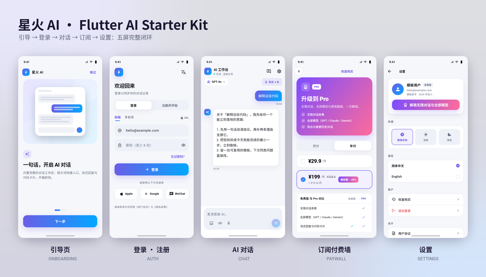
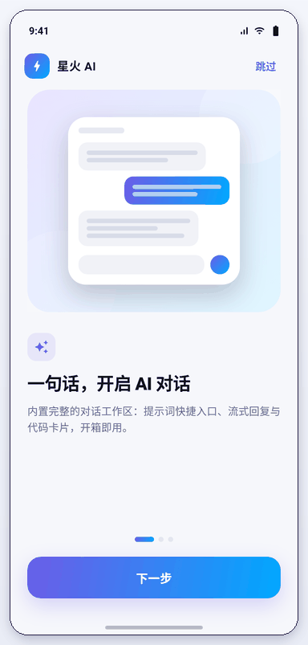
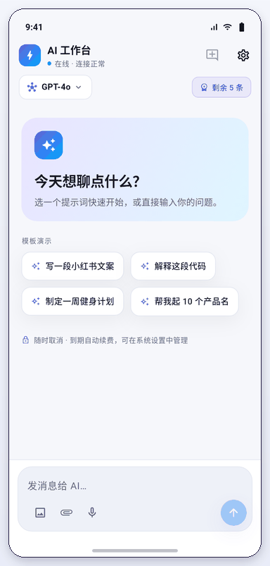

# Flutter AI Starter Kit · AI 对话 + 订阅变现 UI 模板

<div align="center">
  
</div>

<div align="center">

**一套可以直接上线的 Flutter AI 对话 App 界面：引导页 → 登录 → 流式对话 → 订阅付费墙 → 设置，五屏做完。**

Flutter 3.22+ · Material 3 · 深浅色 · 中英双语 · 零第三方依赖 · 31 个 widget 测试全部通过 · `flutter analyze` 0 issue

[中文](#中文) · [English](#english)

</div>

> **本仓库是产品展示主页，不包含 Pro 版源码。** 完整可运行的工程（`lib/`、`test/`、`pubspec.yaml` 全套）在私有仓库中维护，购买后交付。获取方式见 [获取完整 Pro 源码](#获取完整-pro-源码)。

---

## 交互演示 / Live Demos

<p align="center">
  
  
</p>

<p align="center"><sub>左：引导页 → 登录 / 注册　·　右：流式对话 → 订阅付费墙　（真机录屏，不是静态拼图）</sub></p>

---

## 中文

### 这是什么

做 AI 类 App 时，最耗时间的往往不是模型，而是那些"必须有、但没人想再写一遍"的界面：
引导页、登录、对话气泡、流式回复、代码块、模型选择、付费墙、月付年付切换、恢复购买、深浅色、多语言。

这套模板把它们做成一份干净、可直接改的 Flutter 工程：**引导页 → 登录 → AI 工作台 → 付费墙 → 设置**，五个页面连成完整的产品闭环，从视觉到交互都按上架标准打磨过。

### 五个页面

| 页面 | 你能拿到什么 |
|---|---|
| **引导页 Onboarding** | 3 屏滑动引导，每屏一张纯代码绘制的 App 预览图（不依赖图片资源），跳过 / 下一步 / 开始使用，圆点指示器跟随手势平滑过渡 |
| **登录注册 Auth** | 登录 ↔ 注册切换带动画、手机号 / 邮箱切换、密码显隐、表单校验、Apple / Google / 微信三方登录入口，窄屏与大字号下依然不溢出 |
| **AI 工作台 Chat** | 提示词卡片、用户 / AI 气泡、**逐字流式回复**、带语言标签与一键复制的代码卡片、模型选择底部弹层、附件栏、清空对话、免费额度提醒 |
| **付费墙 Paywall** | 渐变 Hero 区、月付 / 年付切换、`最划算 · -45%` 角标、月单价换算、免费版与 Pro 功能对比表、7 天免费试用 CTA、恢复购买、法务小字 |
| **设置 Settings** | 头像与 Pro 状态徽章、主题三态（跟随系统 / 浅色 / 深色）、中英切换、恢复购买、退出登录、协议与版本信息 |

### 功能亮点

| | |
|---|---|
| 🎨 **成套设计系统** | 紫 → 青品牌渐变，Material 3 `ColorScheme` 从一个种子色派生出浅色、深色两套主题；按钮、卡片、输入框、弹窗、底部弹层全部统一 |
| 💬 **真正的流式对话** | 回复逐字追加并自动滚动到底部，代码块先流式结束后渲染成可复制卡片，气泡、时间、状态一致 |
| 💳 **能转化的付费墙** | 年付默认选中并标出折扣、月单价换算降低决策成本、免费与 Pro 逐项对比、恢复购买与法务小字齐备 |
| 🎁 **免费额度拦截** | 对话页顶部常驻「免费额度剩余 N 条」，用完的瞬间自动唤起付费墙——变现闭环的现成演示 |
| 🌗 **深色 + 浅色** | 顶栏一键切换，跟随系统 / 浅色 / 深色三态，切换即时生效并带过渡动画，状态栏图标明暗跟随 |
| 🌏 **中英双语随时切换** | 所有文案集中在一处文案表，运行中切换语言、无需重启，不是"写死两份界面" |
| ⌨️ **键盘收得干净** | 点发送、点空白处、拖动列表、开模型弹层之前键盘都会平滑落下，对话流始终贴底，输入框不会被挡住 |
| 🧱 **零第三方依赖** | 状态管理用 `ChangeNotifier + InheritedNotifier`，不引入 provider / bloc / getx；`flutter pub get` 不会有版本冲突，长期维护成本低 |
| 📱 **按手机尺寸校准** | 320 / 360 / 430 dp 三档宽度与 1.3× 大字号下均无溢出，宽屏也能正常布局 |

### 技术规格

| 项目 | 说明 |
|---|---|
| 框架 | Flutter 3.22+（已在 3.50 / Dart 3.14 验证），`package:flutter/material.dart` |
| 设计语言 | Material 3，种子色派生浅色 / 深色 `ColorScheme`，统一圆角、阴影与渐变 |
| 状态管理 | `ChangeNotifier` + `InheritedNotifier`（`AppState`：主题、语言、Pro 权益） |
| 本地化 | 自建轻量 L10n（中 / 英），运行时可切换，扩展新语言只需加一个枚举分支 |
| 第三方依赖 | 0 |
| 代码量 | 5 屏 + 4 个复用组件 + 模型 / 主题 / 状态层，模块边界清晰 |
| 原生工程 | 不含 `android/` `ios/`，用 `flutter create .` 生成后覆盖 `lib/` 与 `pubspec.yaml` 即可 |

### 质量验证

```
flutter analyze   →  No issues found!          (Flutter 3.50.0 / Dart 3.14.0)
flutter test      →  31 tests, All tests passed!
```

31 个 widget 测试覆盖：

- 冒烟主流程：引导页 → 登录 → 对话 → 付费墙解锁 Pro
- 流式回复与代码卡片渲染
- 运行时中英切换
- 登录 / 注册切换的动画与表单保持
- 引导页指示器跟随手势、滑动落点
- 320 / 360 / 430 dp 窄屏无溢出（顶栏、模型弹层、付费墙、设置）
- 1.3× 大字号与宽屏布局
- 浅色 / 深色下的状态栏图标可读性
- 键盘收起：点发送、点空白处、拖列表、开模型弹层前都平滑落下，输入框不被遮住

### 变现闭环一览

```
用户对话 → 每发一条扣 1 次额度
        → 额度用完的瞬间唤起付费墙
        → 年付方案默认选中（带 -45% 角标）
        → 点「开始 7 天免费试用」→ 你的支付 SDK
        → 成功后 Pro 状态置为开启，全站 PRO 徽章点亮
```

登录、支付、AI 接口在模板里都是**演示实现**（假加载 / 定时器），正式发布前替换成你的 Firebase Auth、RevenueCat、OpenAI / DeepSeek 等服务即可；模板里每一处替换点都留了注释说明。

### 获取完整 Pro 源码

本仓库只做产品展示，源代码不在公开仓库中。Pro 版包含完整可编译工程、全部注释与测试，许可见 [LICENSE-COMMERCIAL.md](LICENSE-COMMERCIAL.md)。

- **购买渠道**：Gumroad 售卖页正在完成收款审核与上线准备，正式链接确认后会更新在这里。
- **在那之前**：可以直接在 [Issues](../../issues) 里留言说明需求，我会把购买方式与最新版本信息发给你。
- **适合谁**：想在一两天内把一个 AI 对话 App 的界面做到可上架水准的独立开发者、外包团队、需要 demo 的创业者。

### 许可

Pro 版采用商业许可，详见 [LICENSE-COMMERCIAL.md](LICENSE-COMMERCIAL.md)：可无限量用于自营商业 App、可闭源修改、可去署名、可用于客户项目（一位开发者一份许可）；不得转售、再分发或公开源码。封面图与文案仅用于展示本产品。

---

## English

### What this is

A production-ready Flutter UI kit for AI chat apps — **onboarding → auth → streaming chat workspace → subscription paywall → settings**, five screens that form a complete product loop, themed for light and dark, bilingual out of the box, with **zero third-party dependencies**.

> This repository is the product showcase. It does **not** contain the source code; the full project lives in a private repository and is delivered with a purchase. See [Get the full Pro source](#get-the-full-pro-source).

### The five screens

| Screen | What it gives you |
|---|---|
| **Onboarding** | Three swipeable pages, each with a code-drawn app preview (no image assets), skip / next / get started, an indicator that tracks the drag smoothly |
| **Auth** | Sign in ↔ sign up switch with an animated transition, phone / email toggle, password visibility, validation, Apple / Google / WeChat entry points — no overflow at narrow widths or large text |
| **Chat workspace** | Prompt chips, user / assistant bubbles, **token-by-token streaming reply**, copyable code card with a language label, model picker sheet, attachment bar, clear conversation, free-quota meter |
| **Paywall** | Gradient hero, monthly / annual toggle, "Best value · −45%" badge, per-month equivalent, free-vs-Pro comparison, 7-day trial CTA, restore purchases, legal footnote |
| **Settings** | Avatar and Pro badge, three-state theme (system / light / dark), language switch, restore purchases, sign out, legal and version info |

### Highlights

- **One design system** — violet → cyan brand gradient; a single seed colour drives both Material 3 colour schemes, so buttons, cards, fields, dialogs and sheets stay consistent.
- **Real streaming feel** — replies append token by token and auto-scroll; the code block streams first, then renders as a copyable card.
- **A paywall built to convert** — annual preselected with a discount badge, per-month equivalent to reduce decision friction, itemised free-vs-Pro comparison, restore flow, legal footnote.
- **Free-quota funnel** — the chat screen meters free messages and opens the paywall the moment they run out.
- **Light and dark** — one-tap toggle, system / light / dark, animated, status-bar icons follow the theme.
- **Runtime bilingual switch** — every string lives in one copy table; switch zh / en without a restart.
- **Zero dependencies** — `ChangeNotifier` + `InheritedNotifier` for state; no provider, bloc or getx, so `flutter pub get` can never drift.
- **Calibrated for phones** — verified at 320 / 360 / 430 dp and at 1.3× text scale, and on wide screens.
- **A keyboard that gets out of the way** — sending, tapping blank space, dragging the feed or opening a sheet all dismiss it smoothly, and the feed stays pinned to the bottom while it resizes.

### Specs

| | |
|---|---|
| Framework | Flutter 3.22+ (verified on 3.50 / Dart 3.14) |
| Design | Material 3, seeded light and dark `ColorScheme`, unified radii, shadows and gradients |
| State | `ChangeNotifier` + `InheritedNotifier` (`AppState`: theme, language, Pro entitlement) |
| Localisation | Lightweight in-house zh / en strings, switchable at runtime |
| Third-party dependencies | none |
| Native projects | `android/` `ios/` not included — generate them with `flutter create .` and drop in `lib/` and `pubspec.yaml` |

### Quality

```
flutter analyze   →  No issues found!          (Flutter 3.50.0 / Dart 3.14.0)
flutter test      →  31 tests, All tests passed!
```

31 widget tests cover the smoke flow (onboarding → sign in → chat → paywall unlock), streaming and the code card, runtime language switch, the auth-tab and onboarding-indicator transitions, overflow at 320 / 360 / 430 dp, 1.3× text scale and wide screens, status-bar legibility in both themes, and the keyboard dismissal polish (send, blank taps, list drags and opening a sheet).

### Get the full Pro source

The source is not in this public repository. The Pro edition ships the complete compilable project with comments and tests, under the [commercial licence](LICENSE-COMMERCIAL.md).

- **Store page**: Gumroad listing is being finalized; the purchase link will be posted here once it is live.
- **Meanwhile**: open an [issue](../../issues) with what you need and I will send the purchase details and current version.

### Licensing

The Pro edition is sold under the [commercial licence](LICENSE-COMMERCIAL.md): unlimited commercial apps you own, closed-source modifications, no attribution required, client work allowed (one licence per developer); no resale, redistribution or public publishing. The cover image and copy are for showcasing this product.
